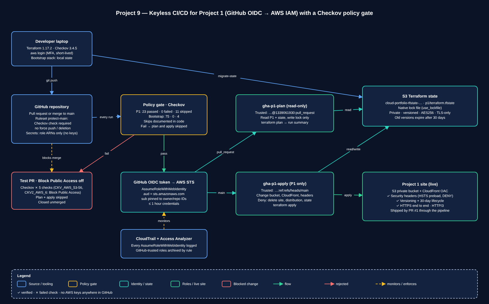

# Project 9: Keyless CI/CD with a Policy-as-Code Gate

Project 1's live site is now deployed by GitHub Actions **with no AWS keys stored anywhere**. GitHub signs in to AWS
through OpenID Connect (OIDC) and gets short-lived credentials for each run. Every change is scanned by **Checkov**
before Terraform touches AWS. Pull requests can only *plan* with a read-only role; only `main` can *apply*, with a role
scoped to Project 1.

This project fixes findings from the [Project 8 Well-Architected review](../project-08-well-architected/): static
CI keys (F-23), tag-pinned actions (F-32), default token permissions (F-33), missing bucket versioning (F-57), and
the absence of anything that would have stopped the public bucket (F-04) before deployment.

## Overview

| Result | Evidence |
|---|---|
| No AWS credentials in GitHub; each run gets temporary credentials through OIDC | [06](evidence/06-first-keyless-run.txt), [00 (screenshot)](evidence/00-github-secrets-names-only.png) |
| Pull requests ran as the read-only `gha-p1-plan` role and changed nothing | [07](evidence/07-pr1-plan-role.txt) |
| First change shipped through the pipeline: security headers, versioning, lifecycle rule | [08](evidence/08-pr1-applied.txt) |
| A pull request that turned off S3 Block Public Access was **blocked**; plan and apply never ran | [09 (screenshot)](evidence/09-gate-blocks-public-bucket.png) |
| The failing check can't be merged by accident (`protect-main` ruleset) | See Results |
| Terraform state moved from the laptop to S3 with native locking | [04](evidence/04-state-migration.txt) |

## Architecture



Editable source: [`diagrams/p9-keyless-cicd.drawio`](diagrams/p9-keyless-cicd.drawio).

```
 Pull request ─► GitHub Actions ─► Checkov ─(pass)─► OIDC token (sub = ...:pull_request)
                                      │                     │
                                   (fail)                   ▼
                                      ▼            STS AssumeRoleWithWebIdentity
                              plan + apply skipped          │
                                                            ▼
                                             gha-p1-plan (read-only) ─► terraform plan
                                                                           │
 Merge to main ─► GitHub Actions ─► Checkov ─(pass)─► OIDC token (sub = ...:ref:refs/heads/main)
                                                            ▼
                                             gha-p1-apply (P1 only, no-delete guardrail)
                                                            ▼
                                     terraform apply ─► S3 site bucket + CloudFront (Project 1)
                                                            │
                         state: s3://cloud-portfolio-tfstate-…/p1/terraform.tfstate (+ .tflock while running)
```

## Components

| Component | What It Is | Used Here |
|---|---|---|
| GitHub OIDC provider (IAM) | Lets AWS trust short-lived identity tokens issued by GitHub Actions | Replaces stored access keys |
| `gha-p1-plan` role | IAM role assumable only by this repository's pull requests | Read P1 resources and state, write only the lock file |
| `gha-p1-apply` role | IAM role assumable only by `main` of this repository | Change P1's bucket, distribution and headers policy; explicit deny on deleting the site, distribution or state bucket |
| S3 state bucket | Versioned, encrypted, private, TLS-only bucket with a 30-day lifecycle on old versions | Shared Terraform state for laptop and CI |
| Terraform S3 native locking (`use_lockfile`) | Lock file stored next to the state, no DynamoDB table (Terraform 1.11+) | Prevents two runs writing state at once |
| Checkov 3.4.5 | Open-source policy-as-code scanner for Terraform | Gate before plan and apply; also run locally before pushing |
| GitHub Actions workflow | `.github/workflows/p1-terraform.yml` at the repository root | Checkov → plan (PRs) / apply (main), actions pinned to commit SHAs |
| `protect-main` ruleset | GitHub branch ruleset | Requires `Policy gate (Checkov)`, blocks force pushes and deletion of `main` |
| IAM Access Analyzer archive rule | Rule that archives findings only for roles trusted by the GitHub OIDC provider | Keeps intended external trust documented, any other external access still raises a finding |
| CloudFront response headers policy | HSTS (1 year, subdomains, preload), `nosniff`, `X-Frame-Options: DENY`, referrer and XSS headers | First change shipped through the pipeline |

## Design Decisions

**Why OIDC instead of access keys in GitHub Secrets?**
Stored keys never expire on their own and leak with the repository's secrets. With OIDC, GitHub issues a signed token
for each run, AWS checks the issuer, audience and subject, and the credentials last at most an hour. There's nothing
long-lived to steal. The two role ARNs are stored as GitHub secrets only so that GitHub masks the account ID in public logs.
They aren't credentials.

**Why two roles?**
Anyone who can open a pull request shouldn't be able to change production. The trust policy compares the token's
`sub` claim exactly: `…:pull_request` can only assume the read-only role, and `…:ref:refs/heads/main` can only assume
the apply role. By default, pull requests from forks don't receive an OIDC token.

**Why pin the subject to numeric IDs?**
The first run failed with `Not authorized to perform sts:AssumeRoleWithWebIdentity`. CloudTrail Event History showed
the real claim: `repo:ZeiadAlOmari@318468395/cloud-portfolio@1339061930:ref:refs/heads/main`. GitHub includes the
immutable owner and repository IDs, so the trust now matches them exactly. If the repository were renamed or deleted and
someone recreated the name, their token wouldn't match. Wildcards would have hidden the problem and weakened the trust.

**Why can't the apply role delete anything important?**
An explicit `Deny` on `s3:DeleteBucket` (site and state bucket) and `cloudfront:DeleteDistribution` outranks any allow.
A bad merge can change the site but can't destroy it or the state that tracks it.

**Why Checkov, and why are some checks skipped?**
Checkov runs in seconds, needs no account, and would have flagged the original public bucket (six checks fail on the
pre-Project 8 code). Every skip is written next to the resource with its reason, so a reviewer sees *why*, not just
*that*. All 11 remaining P1 skips are cost decisions from Project 8 (WAF, custom TLS certificate, access logs, KMS,
replication, origin failover) or not applicable (geo restriction, event notifications). Three temporary skips were
removed by fixing the code in the first pull request.

**Why define the security-headers policy instead of using AWS's managed one?**
Checkov didn't recognise the managed `SecurityHeadersPolicy` referenced by ID. Defining it as a resource makes the
settings visible in code and allowed a stronger HSTS setting (`includeSubDomains`, `preload`).

**Why one Checkov run per directory?**
A single run with two `-d` flags was found to scan the first directory twice and skip the second, which is a silent
gap. The workflow scans each directory separately.

**Why does the bootstrap stack use local state?**
It creates the remote-state bucket, so it can't store its own state there before the bucket exists. It's small, changes
rarely, and is applied from the laptop with an MFA-backed `aws login` session.

**Why does the ruleset have an admin bypass?**
Other projects in this repository are still pushed directly to `main`. With the bypass, a failing pull request still
can't be merged by default; overriding it takes a deliberate "bypass rules" click.

## Results / Verification

| Test | Result |
|---|---|
| Run #1 (push to `main`) | Checkov passed; `AssumeRoleWithWebIdentity` denied 12 times. CloudTrail revealed the `sub` format mismatch ([05](evidence/05-oidc-failure.txt), [screenshot](evidence/05-run1-oidc-denied.png)) |
| Run #2 after the trust fix | `SUCCESS gha-p1-apply`, `No changes` ([06](evidence/06-first-keyless-run.txt), [screenshot](evidence/06-run2-success.png)) |
| PR #1 checks | Checkov passed, plan passed as `gha-p1-plan`, apply skipped; versioning still `None` afterwards ([07](evidence/07-pr1-plan-role.txt), [screenshot](evidence/07-pr1-checks-passed.png)) |
| PR #1 merged | Apply: 3 added, 1 changed. Live headers present, versioning `Enabled`, lifecycle `expire-old-site-versions 30`, site `200` ([08](evidence/08-pr1-applied.txt)) |
| Test PR: Block Public Access turned off | Checkov failed (CKV_AWS_53/54/55/56, CKV2_AWS_6); plan and apply skipped; closed unmerged ([09](evidence/09-gate-blocks-public-bucket.png)) |
| `protect-main` ruleset (GitHub API) | `deletion`, `non_fast_forward`, `required_status_checks: Policy gate (Checkov)` from GitHub Actions |
| Bootstrap verification | State bucket private, versioned, AES256, lifecycle 30 days, `IsPublic=False`; trust conditions exact ([02](evidence/02-bootstrap-verify.txt)) |
| Access Analyzer | 0 active findings; the two GitHub-trusted roles archived by rule `github-oidc-trusted-roles` ([03](evidence/03-analyzer-archive-rule.txt)) |
| Checkov | P1: 23 passed, 0 failed, 11 skipped. Bootstrap: 75 passed, 0 failed, 4 skipped |

## Cost Analysis

| Item | Cost |
|---|---|
| GitHub Actions (public repository) | USD 0 |
| IAM OIDC provider, roles, Access Analyzer archive rule | USD 0 |
| Checkov, Terraform | USD 0 (open source) |
| CloudFront response headers policy | USD 0 |
| S3 state bucket (about 15 KB, a few requests per run) and site-bucket versioning (one 16 KB object) | Fractions of a cent per month |

Not used, for cost: DynamoDB lock table (replaced by S3 native locking), customer-managed KMS keys, S3 access logging
for the state bucket.

## Known Limitations

- **One workload.** Only Project 1 is deployed by the pipeline; the other projects are torn down.
- **Admin bypass.** The repository admin can still push to `main` directly or merge past a failing check, deliberately.
- **No required review.** As a single-maintainer repository, pull requests don't require a second approver.
- **Plan output isn't posted as a PR comment.** It goes to the run summary to avoid granting `pull-requests: write`.
- **Checkov is a static scanner.** It checks Terraform code, not drift made outside Terraform; a scheduled plan would catch drift.
- **The bootstrap stack's state is local**, by design (see Design Decisions).
- **Access Analyzer archive rule** trusts any role whose trust names the GitHub OIDC provider, so new roles trusting that provider need the same review as these two.

## Deployment

```bash
# 1. Bootstrap (once, from a workstation with an MFA-backed session)
cd project-09-keyless-cicd/terraform
terraform init && terraform plan -out=bootstrap.tfplan && terraform apply bootstrap.tfplan

# 2. Move Project 1's state to S3 (add backend.tf, then)
cd ../../project-01-static-site/terraform && terraform init -migrate-state

# 3. GitHub: add repository secrets AWS_PLAN_ROLE_ARN and AWS_APPLY_ROLE_ARN
#    https://github.com/<owner>/<repo>/settings/secrets/actions
# 4. GitHub: ruleset requiring "Policy gate (Checkov)"
#    https://github.com/<owner>/<repo>/settings/rules

# 5. Local check before pushing
checkov --framework terraform --compact --quiet -d project-01-static-site/terraform

# 6. Publish evidence without the account ID
bash project-09-keyless-cicd/scripts/sanitize-evidence.sh
```

## What I Learned

- **Read the real claim before writing the trust policy.** GitHub's `sub` included immutable IDs, and CloudTrail showed exactly what it sent. Debugging from evidence took minutes; guessing with wildcards would have weakened the design.
- **Split privileges by context, not by person.** The same repository gets read-only access on pull requests and scoped write access only on `main`.
- **Explicit denies are cheap insurance.** The apply role can't delete the site or the state, whatever else is granted.
- **Scanners have blind spots too.** Checkov didn't recognise a managed policy referenced by ID, and silently skipped a directory when given two at once. Test the gate itself.
- **A gate needs enforcement.** A failing check still left the merge button clickable until a ruleset made it required.
- **Workflows only run from the repository root,** and changing them needs a token with `workflow` scope.
- **Terraform 1.11+ locks state in S3 itself,** so a DynamoDB lock table is no longer needed.
- **Never run git with sudo.** Two root-owned files in `.git` from an old `sudo git pull` later broke `git fetch`.
