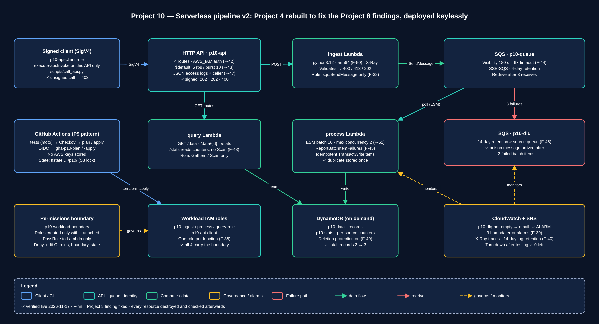

# Project 10: Serverless Pipeline v2

Project 4's serverless data pipeline, rebuilt to fix what the
[Project 8 Well-Architected review](../project-8-well-architected/) found wrong with it. It's deployed by the keyless
pipeline from [Project 9](../project-9-keyless-cicd/): no AWS keys in GitHub, unit tests and a Checkov gate before
every plan, and an apply role that can only create IAM roles carrying a permissions boundary.

The original API was open to anyone, unthrottled, and ran forgotten for about 8 weeks (P8 F-36, F-42, F-43). Version 2
requires a signed request on every route, limits the request rate, retries only the messages that fail, stores each
message exactly once, raises an alarm when data is rejected, and was **torn down and checked to be empty** after testing.

## Overview

| Result | Evidence |
|---|---|
| Every route requires SigV4 (AWS_IAM): unsigned call **403**, signed calls **202 / 202 / 400** | [06](evidence/06-deploy-verify-after-fix.txt), [09](evidence/09-access-logs-xray.txt) |
| End to end through SQS to DynamoDB in about 1 second; `/stats` read from a counters table | [06](evidence/06-deploy-verify-after-fix.txt) |
| The same message delivered twice was **stored and counted once** | [07](evidence/07-failure-and-idempotency.txt) |
| A malformed message failed 3 times, moved to the **DLQ**, and the alarm **e-mailed** | [08](evidence/08-dlq-alarm.txt) |
| Deployed only by GitHub Actions through OIDC; every workload role carries the boundary | [01](evidence/01-deploy-verify.txt) |
| A hidden failure in the pipeline was found, explained and fixed (see Design Decisions) | [02](evidence/02-api-404-diagnosis.txt)–[05](evidence/05-stage-calls.txt) |
| **13 Project 8 findings fixed** in the design (table below) | |
| 35 resources destroyed, then confirmed **0** by direct AWS CLI queries | [10](evidence/10-teardown.txt), [11](evidence/11-teardown-verify.txt) |
| A **deploy switch** keeps it down: merges to `main` skip apply while `P10_DEPLOY_ENABLED` is off | [12 (screenshot)](evidence/12-deploy-switch-off.png) |

### Project 8 findings fixed

| Finding | Was (Project 4) | Now (Project 10) |
|---|---|---|
| F-42 🔴 | All routes `authorization_type: NONE` | `AWS_IAM` on all 4 routes; callers need `execute-api:Invoke` |
| F-43 🔴 | No stage throttling | `$default` stage: 5 requests/s, burst 10 |
| F-38 🟠 | One role for all functions; `logs` on `*` | One role per function, scoped to its own log group, queue and tables |
| F-39 🟠 | No alarms | DLQ-depth alarm and an error alarm per function, to an SNS e-mail topic |
| F-40 🟠 | Log groups never expire, orphaned by destroy | Terraform-managed log groups, 14-day retention, removed by destroy |
| F-44 🟠 | Visibility timeout = function timeout (60 s) | 180 s, six times the 30 s process timeout |
| F-45 🟠 | One bad message retried the whole batch | `ReportBatchItemFailures`; only the failed message is retried |
| F-47 🟠 | No access logs or tracing | JSON access logs with caller identity; X-Ray active on every function |
| F-46 🟡 | DLQ retention = source retention | DLQ keeps messages 14 days, source 4 days |
| F-48 🟡 | `/stats` scanned the whole table | Counters kept in `p10-stats`, updated in the same transaction |
| F-49 🟡 | Deletion protection off | Deletion protection on (PITR stays off: cost decision) |
| F-50 🟡 | x86_64 | arm64 (Graviton) |
| F-51 🟡 | No concurrency limit | Capped with SQS `maximum_concurrency = 2` and API throttling (see Known Limitations) |

F-41 (DLQ with redrive) was a strength and was kept. F-36 is answered by the verified teardown and the deploy switch.

## Architecture



Editable source: [`diagrams/p10-serverless-v2.drawio`](diagrams/p10-serverless-v2.drawio).

```
 client (assumes p10-api-client) ──SigV4──► HTTP API p10-api  ($default: 5 rps / burst 10, access logs)
                                              │                         │
                                       POST /ingest            GET /data · /data/{id} · /stats
                                              ▼                         ▼
                                       ingest Lambda              query Lambda ──read──┐
                                              │ SendMessage                            │
                                              ▼                                        ▼
                         p10-queue (vis 180 s) ──ESM, max 2──► process Lambda ──► DynamoDB p10-data
                                              │                  (partial batch     + p10-stats counters
                                   3 failures │                   failures,          (one transaction)
                                              ▼                   idempotent)
                                       p10-dlq (14 days) ◄── alarm p10-dlq-not-empty ──► SNS ──► e-mail

 GitHub Actions: tests (moto) ► Checkov ► OIDC ► gha-p10-plan (PR) / gha-p10-apply (main) ► terraform
                 roles it creates must carry p10-workload-boundary · state: S3 p10/terraform.tfstate
```

## Components

| Component | What It Is | Used Here |
|---|---|---|
| API Gateway HTTP API `p10-api` | Managed HTTP front door | 4 routes with `AWS_IAM` authorization, throttled `$default` stage, JSON access logs |
| `p10-api-client` role | IAM role allowed only `execute-api:Invoke` on this API | The signed caller used for testing |
| `scripts/call_api.py` | Small SigV4 client using botocore | Signed and unsigned calls, optionally assuming the client role |
| `p10-ingest` Lambda | Python 3.12, arm64 | Validates the body (400/413), queues the message, returns 202 |
| SQS `p10-queue` + `p10-dlq` | Queue with SSE-SQS and a redrive policy | Decouples ingest from processing; poison messages land in the DLQ after 3 receives |
| `p10-process` Lambda | SQS consumer, batch 10, maximum concurrency 2 | Stores each record and updates counters in one `TransactWriteItems`; returns failed items only |
| `p10-query` Lambda | Read API | Lists records (1–100), gets one by id, reads `/stats` from counters |
| DynamoDB `p10-data`, `p10-stats` | On-demand tables with deletion protection | Records, and per-source plus total counters |
| CloudWatch alarms + SNS `p10-alarms` | DLQ-depth and per-function error alarms; topic encrypted with the AWS-managed key | E-mail when data is rejected or a function fails |
| X-Ray | Active tracing on every function | Per-invocation traces of each function |
| `p10-workload-boundary` | IAM permissions boundary (Project 9 bootstrap stack) | Caps what any P10 role can do, even if its own policy is wider |
| `gha-p10-plan` / `gha-p10-apply` | OIDC-trusted CI roles (Project 9 bootstrap stack) | Plan on pull requests, apply on `main`; nothing stored in GitHub but role ARNs |
| `.github/workflows/p10-terraform.yml` | GitHub Actions workflow | Unit tests (pytest + moto) and Checkov, then plan or apply; docs-only changes don't start it |
| `P10_DEPLOY_ENABLED` | GitHub repository variable | Deploy switch: apply runs only while it's `true` (now `false`) |
| `tests/test_functions.py` | 5 unit tests against moto's in-memory AWS | Validation, partial batch failures, idempotency, `/stats` |

## Design Decisions

**Why IAM authorization rather than API keys or Cognito?**
The callers are systems, not people. SigV4 with an IAM role is free, needs no user pool, gives short-lived credentials,
and puts the caller's identity in the access logs (`caller: AROA…:p10-api-test`). API keys identify a caller but don't
authenticate one, and Cognito adds a service to run for no gain here.

**Why a permissions boundary on everything the pipeline creates?**
The apply role must create IAM roles for the functions, and a role that can create roles can normally give itself any
permission. The apply role may create `p10-*` roles only when `p10-workload-boundary` is attached, may pass them only
to Lambda, and is explicitly denied removing the boundary, editing any managed policy, or deleting the state bucket.
A bad merge can't escalate past the boundary.

**Why a transaction with `attribute_not_exists(id)`?**
SQS delivers at least once, so the same message can arrive twice. The record and both counters are written together,
and only if the id is new. A duplicate fails the condition and is skipped as a duplicate rather than an error; the test
in [07](evidence/07-failure-and-idempotency.txt) delivered `dup-test-0001` twice and the total went from 2 to 3.

**Why a separate counters table?**
Project 4 answered `/stats` by scanning the whole table, so cost and latency grew with the data (F-48). Reading a
handful of counter rows costs the same at any size.

**Why `maximum_concurrency` instead of reserved concurrency?**
This account's total Lambda concurrency limit is 10, and Lambda must keep at least 10 unreserved, so nothing can be reserved. The SQS
event source mapping's `maximum_concurrency = 2` caps the consumer and the stage throttle caps the API. The Checkov
check for reserved concurrency is skipped with that reason.

**Why did the first deployment return 404 on every route, while the pipeline showed green?**
`CreateStage` was denied, so no stage existed, and an API without a stage answers 404. The apply step ran
`terraform apply | tee`, and GitHub Actions' default shell doesn't set `pipefail`, so the exit code was `tee`'s: success.
Adding `defaults: run: shell: bash` (which sets `pipefail`) to both workflows made the next run fail properly and show the real
error: creating a **tagged** stage also needs `apigateway:TagResource`. With that added, the stage was created.
Access-logging permissions that AWS documents as required were added on the way and kept.

**Why does the apply role have `logs:CreateLogGroup` on `*`?**
Enabling HTTP API access logging checks those `logs` permissions with `Resource: "*"`, as documented by AWS. It's the
one wide grant, it's limited to log-delivery actions, and the boundary still applies to every workload role.

**Why a deploy switch?**
With the stack torn down, the next code change merged to `main` would have recreated it, quietly, the same way Project 4
stayed alive without anyone deciding it should. Apply now runs only while the repository variable `P10_DEPLOY_ENABLED`
is `true`; otherwise a "Deploy switch is off" job records the skip in the run summary. Pull requests still get tests,
Checkov and a read-only plan, so the code stays checked while nothing runs. Changes to `*.md`, `diagrams/` and
`evidence/` don't start the workflow at all.

**Why is the e-mail subscription not in Terraform?**
The address would be committed to a public repository. It was added once with `aws sns subscribe` and removed with the
topic at teardown.

## Results / Verification

| Test | Result |
|---|---|
| Deployment through the pipeline | 34 of 35 resources; all 4 workload roles show the boundary; functions arm64, Active tracing ([01](evidence/01-deploy-verify.txt)) |
| First API calls | 404 on every route: no stage. Pipeline green because of the missing `pipefail` ([02](evidence/02-api-404-diagnosis.txt), [03](evidence/03-stage-missing.txt)) |
| Run after the `pipefail` fix | Failed as it should: `apigateway:TagResource` denied ([04](evidence/04-apply-errors.txt), [05](evidence/05-stage-calls.txt)) |
| Run after the permission fix | `1 added`: `$default` stage, burst 10, rate 5, access logs on ([06](evidence/06-deploy-verify-after-fix.txt)) |
| Unsigned call | `403 Forbidden`; access log shows `caller: -` and the IAM authorizer's error ([09](evidence/09-access-logs-xray.txt)) |
| Signed ingest ×3 | `202`, `202`, `400` (body without `data`) |
| After 20 s | `/stats`: `total_records 2`, `sensor-a 1`, `sensor-b 1`; `/data` lists both, status `processed` |
| Duplicate delivery | Same id sent to the queue twice: `total_records 3`, `dup-test 1` ([07](evidence/07-failure-and-idempotency.txt)) |
| Poison message | 3 × `failed=1`, main queue 0, DLQ 1, `p10-dlq-not-empty` **ALARM** about 12 minutes after sending, e-mail received ([08](evidence/08-dlq-alarm.txt)) |
| Function error alarms | Stayed `OK`, as designed: a reported batch-item failure isn't a function error |
| Latency (access logs) | About 1 s on a cold start, 58–90 ms warm |
| X-Ray | 12 traces, no errors or faults |
| Unit tests | 5 passed (pytest + moto) |
| Checkov | P10: 109 passed, 0 failed, 27 skipped (per resource instance). Bootstrap: 146 passed, 0 failed, 6 skipped |
| Deploy switch | Run #7 (merge of the workflow change, switch `false`): tests and Checkov passed, "Deploy switch is off" ran, apply skipped; Lambda, API and DynamoDB still 0 afterwards ([12](evidence/12-deploy-switch-off.png)) |
| Teardown | `Destroy complete! Resources: 35 destroyed`; state empty; Lambda, ESM, DynamoDB, SQS, API, SNS, alarms, log groups and `p10-*` roles all **0** ([10](evidence/10-teardown.txt), [11](evidence/11-teardown-verify.txt)) |

## Cost Analysis

The stack was live for about 5 hours with a few dozen requests. Everything used falls under the AWS Free Tier:

| Item | Cost |
|---|---|
| Lambda (3 functions, arm64, 128 MB), API Gateway HTTP API, SQS, DynamoDB on demand | USD 0 (free tier) |
| CloudWatch: 4 alarms, logs, 14-day retention | USD 0 (10 alarms and 5 GB of logs free) |
| SNS e-mail, X-Ray traces | USD 0 (1,000 e-mails and 100,000 traces free) |
| GitHub Actions (public repository), IAM, Terraform state in S3 | USD 0 / fractions of a cent |

Not used, for cost (Checkov skips record each one): DynamoDB point-in-time recovery, customer-managed KMS keys,
VPC-attached functions (would need NAT or endpoints), WAF, Lambda code signing.

## Known Limitations

- **HTTP APIs don't support X-Ray.** Traces start at the Lambda function; a REST API would trace the API too.
- **SQS breaks the trace in two.** The ingest call and the later process call appear as separate traces.
- **Function error alarms don't see bad data.** Rejected messages are reported as failed batch items, not errors;
  the DLQ alarm is what catches them, after about 10–12 minutes (3 × 180 s visibility plus the alarm period).
- **No reserved concurrency** (account limit of 10); consumer and API are capped instead.
- **`GET /data` is a bounded scan** (1–100 items) without pagination.
- **The test client role trusts one IAM user** in this account; a real caller would get its own role.
- **Teardown ran from the laptop**, not the pipeline, after switching off deletion protection. There's no destroy job,
  on purpose: the apply role isn't meant to remove data.
- **The CI roles and boundary remain** (Project 9 bootstrap stack), at no cost, so the stack can be redeployed by
  switching `P10_DEPLOY_ENABLED` to `true` and running the workflow.
- **Docs-only pull requests run no workflow**, so the required `Policy gate (Checkov)` check never reports on them;
  docs are pushed directly by the repository admin.

## Deployment

```bash
# 1. CI roles and boundary (Project 9 bootstrap stack, from a workstation with an MFA-backed session)
cd project-9-keyless-cicd/terraform && terraform apply

# 2. Repository secrets AWS_P10_PLAN_ROLE_ARN and AWS_P10_APPLY_ROLE_ARN
#    https://github.com/<owner>/<repo>/settings/secrets/actions

# 3. Deploy switch: repository variable P10_DEPLOY_ENABLED = true
#    https://github.com/<owner>/<repo>/settings/variables/actions
# 4. Deploy: open a pull request (tests + Checkov + plan), then merge (apply), or run the workflow manually
#    https://github.com/<owner>/<repo>/actions/workflows/p10-terraform.yml

# 5. Optional: alarm e-mails (kept out of Git)
aws sns subscribe --topic-arn "$(terraform -chdir=project-10-serverless-v2/terraform output -raw alarm_topic_arn)" \
  --protocol email --notification-endpoint you@example.com

# 6. Call the API as the client role
cd project-10-serverless-v2
python scripts/call_api.py "$(terraform -chdir=terraform output -raw api_endpoint)" POST /ingest \
  '{"source":"sensor-a","data":{"temp":21.5}}' --role "$(terraform -chdir=terraform output -raw client_role_arn)"

# 7. Teardown: switch off deletion protection, destroy, check with the AWS CLI, set P10_DEPLOY_ENABLED = false
terraform -chdir=terraform apply -var protect_data=false
terraform -chdir=terraform destroy -var protect_data=false

# 8. Publish evidence without account ID, e-mail, IP or role IDs
bash scripts/sanitize-evidence.sh
```

## What I Learned

- **A green pipeline can be lying.** `command | tee` hides the command's failure unless `pipefail` is on, and GitHub
  Actions only sets it when the shell is named explicitly. The apply failed silently and the API had no stage.
- **Read the error before adding permissions.** Guessing produced the right access-logging permissions but not the
  missing one; once the error was visible, it named `apigateway:TagResource` exactly.
- **Tags need their own permission.** Creating a tagged resource can be checked separately from creating it.
- **A permissions boundary makes role-creating pipelines safe**, and it's free.
- **New accounts have low limits.** Total Lambda concurrency here is 10, which rules out reserved concurrency.
- **Partial batch failures change what "error" means.** The function succeeds while reporting the bad message, so
  the alarm belongs on the DLQ.
- **Deletion protection works on its owner too.** Teardown takes a deliberate first step to switch it off.
- **Verify the teardown outside the tool that did it.** Project 4 was forgotten for 8 weeks; this one was checked
  service by service.
- **"Torn down" should be a control, not a promise.** Without the deploy switch, the next merge would have rebuilt the
  stack.
