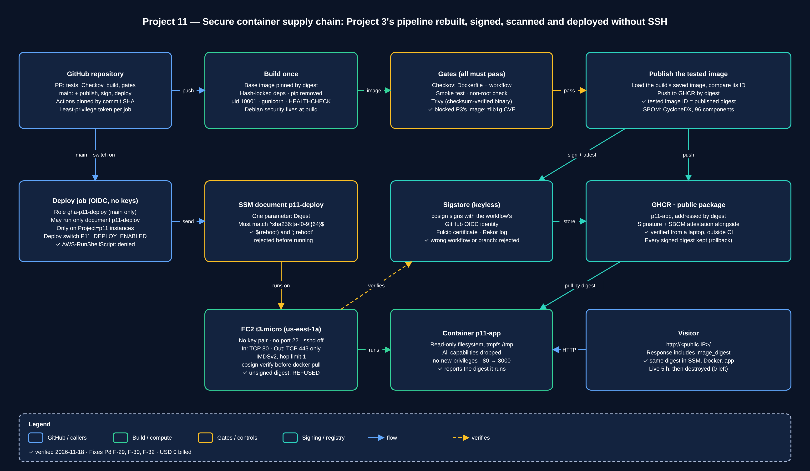

# Project 11: Secure Container Supply Chain

Project 3's CI/CD pipeline, rebuilt so that the image that passes the tests is exactly the image that runs, every image
is scanned and signed, and nothing is deployed over SSH. It fixes three findings from the
[Project 8 Well-Architected review](../project-08-well-architected/): **F-29** (SSH deploys, port 22 open), **F-30**
(the tested image was thrown away and rebuilt on the server) and **F-32** (no image scan, actions pinned by tag).

The tools are vendor-neutral and free: **Trivy** (vulnerabilities, SBOM), **Checkov** (policy), **cosign** with
**Sigstore** (keyless signing), **GitHub Actions** with **GHCR**. AWS is used only as the deploy target, through
**SSM** instead of SSH. The live part ran for 5 hours and was destroyed; **nothing was billed**.

## Overview

| Result | Evidence |
|---|---|
| Project 3's own app, copied unchanged, **failed the gates**: a fixable High CVE (zlib1g) and a root container | [ci-1](evidence/ci-1-p3-baseline-trivy.txt), [checks](evidence/ci-1-p3-baseline-pr-checks.png) |
| The hardened image passed: **0 fixable High/Critical**, non-root, hash-locked dependencies | [ci-2](evidence/ci-2-hardened-build-publish.txt) |
| **Tested image ID = published digest** in both publish summaries checked (`c6947d49…`, `b43468bb…`); the deployed build `07557ee3…` was published the same way | [ci-2](evidence/ci-2-hardened-build-publish.txt), [ci-3](evidence/ci-3-phase4-build-publish.txt) |
| Signature checked **from a laptop, outside CI**: valid only for this workflow on `main`; two other identities rejected | [01](evidence/01-verify-signature.txt) |
| Deploy target with **no key pair, no port 22, sshd disabled**; port 22 unreachable from the internet | [02](evidence/02-instance-ready.txt) |
| Deployed **by digest through SSM**: the same digest in the SSM command, Docker, and the app's own response | [05](evidence/05-deploy-verify.txt) |
| **10 of 10 negative tests passed**: unsigned digest refused by the instance, injection rejected, CI role can't run a shell | [06](evidence/06-negative-tests.txt) |
| 6 resources destroyed, then confirmed gone by direct AWS CLI queries | [07](evidence/07-teardown.txt), [08](evidence/08-teardown-verify.txt) |

### Project 8 findings fixed

| Finding | Was (Project 3) | Now (Project 11) |
|---|---|---|
| F-29 🔴 | Deploy over SSH (`appleboy/ssh-action@v1`); port 22 open to `0.0.0.0/0`; private key in GitHub Secrets | No key pair, no port 22, sshd disabled. CI may only run one SSM document on P11-tagged instances |
| F-30 🟠 | CI built and tested an image, then discarded it; the server ran `git pull` and `docker build` again | Built once; the tested image is saved, reloaded, its ID compared, pushed, signed and deployed by digest |
| F-32 🟠 | No image scan; actions pinned by tag | Trivy gate and SBOM on every build; every action pinned by commit SHA; Trivy itself checksum-verified |
| F-31 🟠 (half) | Downtime on every deploy, no rollback image | Every signed digest stays in GHCR, so rollback is a redeploy by digest. The container is still replaced in place: a few seconds of downtime remain |

F-23 (static AWS keys) and F-33 (default token scopes) in the same pipeline were fixed earlier, in
[Project 9](../project-09-keyless-cicd/).

## Architecture



Editable source: [`diagrams/p11-secure-supply-chain.drawio`](diagrams/p11-secure-supply-chain.drawio).

```
 pull request ─► unit tests ─┐
                Checkov ─────┤ (Dockerfile + workflow)
                             ▼
               build ONCE ─► smoke test ─► non-root gate ─► Trivy gate (fixable High/Critical) ─► SBOM
                             │                                   PR stops here; nothing is published
 push to main ───────────────┘
               save tested image ─► publish job: load, compare image ID ─► push to GHCR by digest
                                                                       ─► cosign sign + attest SBOM (keyless, OIDC)
                                                                       ─► cosign verify
               deploy job (only if P11_DEPLOY_ENABLED = true):
                 GitHub OIDC ─► gha-p11-deploy ─► ssm:SendCommand p11-deploy(Digest) ─► P11-tagged instance only
                                                                        │
                 EC2 (no SSH): cosign verify digest ─► REFUSE if unsigned │ docker pull @digest ─► run read-only, non-root
                                                                        ▼
                 visitor ─► http://<ip>/ ─► {"image_digest": "sha256:…", "version": "2.0.0", …}
```

## Components

| Component | What It Is | Used Here |
|---|---|---|
| `app/` | Project 3's Flask app, version 2.0.0 | Reports the digest it runs from; 4 unit tests |
| `app/Dockerfile` | Container build | Base pinned by digest, Debian security fixes, hash-locked deps, pip removed, uid 10001, HEALTHCHECK, gunicorn |
| `app/requirements*.txt` | pip-compile lock files with hashes | pip refuses any package whose hash differs |
| `.github/workflows/p11-supply-chain.yml` | GitHub Actions pipeline | tests → Checkov → build/gates → publish/sign → deploy; per-job permissions |
| Trivy v0.76.1 | Vulnerability scanner and SBOM generator | Installed as a binary checked against its published SHA-256; gate on fixable High/Critical |
| Checkov 3.4.5 | Policy-as-code scanner | Dockerfile (48 checks) and the workflow itself (140 checks) |
| cosign v3.1.4 / Sigstore | Keyless signing: Fulcio certificate from the workflow's OIDC identity, Rekor transparency log | Signs the digest, attests the SBOM; verified in CI, on the instance and from a laptop |
| GHCR `p11-app` | GitHub's container registry, public package | Images addressed by digest, with signatures and attestations stored alongside |
| `gha-p11-deploy` | IAM role trusted by GitHub OIDC, `main` only (Project 9 bootstrap stack) | `ssm:SendCommand` on document `p11-deploy` and on instances tagged `Project=p11-secure-supply-chain` |
| SSM document `p11-deploy` | Run Command document with one parameter | Digest must match `^sha256:[a-f0-9]{64}$`; verifies the signature, then pulls and runs |
| EC2 `t3.micro` | Amazon Linux 2023, us-east-1a | No key pair, no port 22, sshd disabled, IMDSv2 (hop limit 1), encrypted disk; HTTP in, HTTPS out only |
| `P11_DEPLOY_ENABLED` | GitHub repository variable | Deploy switch, as in Project 10; `false` now |
| `scripts/verify-image.sh` | Verification from outside CI | Public pull, signature identity, wrong identities rejected, SBOM attestation |
| `scripts/negative-tests.sh` | The refusal tests | Unsigned digest, malformed and injected digests, IAM policy simulation |

## Design Decisions

**Why not use `aquasecurity/trivy-action`?**
In March 2026 attackers force-pushed most `trivy-action` version tags to malicious commits and published a malicious
Trivy binary (v0.69.4). Workflows pinned by tag ran the attacker's code; workflows pinned by commit SHA didn't. Here
Trivy is downloaded at a fixed version and checked against its SHA-256 before it runs, and every remaining action is
pinned by commit SHA. The only third-party action left is Sigstore's installer.

**Why wait about 14 days before adopting a release?**
Compromised releases are usually found within days. Tools, actions and Python packages were pinned to the newest
version at least about two weeks old: gunicorn 26.2.0 rather than 27.0.1 (6 days old), click 8.5.0 rather than
8.5.1 (12 days old). Project 3's unpinned install had quietly picked up click 8.5.1.

**How is "build once" enforced?**
The build job saves the exact image it tested; the publish job loads it and refuses to continue unless its image ID
matches the tested one. Both publish summaries checked show the tested image ID equal to the pushed digest. Deployment uses
that digest, never a tag.

**Why does the instance verify the signature, when CI already did?**
Because the instance is the last point that can say no. Anyone able to send the SSM command, including an admin, can
only get a digest run if it carries a valid signature from this workflow on `main`. The negative test sent an
unsigned digest that really exists in the same repository: the instance refused it, and the running app was untouched.

**Why a custom SSM document instead of `AWS-RunShellScript`?**
`AWS-RunShellScript` is a remote shell, the same power SSH gave Project 3. The CI role may only run `p11-deploy`,
whose single parameter must look like a digest. The IAM policy simulator confirms the role is denied
`AWS-RunShellScript` and denied instances tagged for other projects; SSM rejected `sha256:$(reboot)` and
`<digest>; reboot` before anything ran.

**Why keyless signing?**
There is no signing key to store, rotate or leak. The certificate names the repository, workflow and branch that
signed, and the signature is recorded in Sigstore's public transparency log. Verification pins that identity.

**Why does the gate ignore unfixed vulnerabilities?**
The base image has 47 High findings with no fix published yet (util-linux, ncurses, sqlite, systemd libraries, perl).
Blocking on them would block every build without making anything safer. The gate blocks what can be fixed, and the
full list is printed on every run. The first run proved the point: Project 3's image was blocked on the one fixable
High, zlib1g CVE-2026-85091.

**Why apply Debian updates during the build?**
The pinned base image lagged behind a published zlib fix. `apt-get upgrade` at build time picks up such fixes; the
trade-off is that builds aren't reproducible byte for byte, which is acceptable because deployment is by digest.

**Why is the package public?**
So the instance can pull without credentials and anyone can verify the signature. The image contains only the code and
public packages already in this public repository.

## Results / Verification

| Test | Result |
|---|---|
| Project 3's app, unchanged | Checkov failed (no HEALTHCHECK, no USER); Trivy: 48 High, **1 fixable** (zlib1g) → blocked; container runs as root |
| Hardened app | Checkov 48/0 (Dockerfile), 140/0 (workflow); Trivy: 47 High, **0 fixable**; uid 10001; 4 unit tests |
| SBOM | CycloneDX, 96 components; the 8 Python packages exactly as locked |
| Publish | Tested image ID = published digest (`c6947d49…`, `b43468bb…`); signature and SBOM attestation verified in CI each time |
| Signature from a laptop | Valid for `p11-supply-chain.yml@refs/heads/main`; rejected for `p1-terraform.yml` and for `refs/heads/attacker-branch`; SBOM attestation valid ([01](evidence/01-verify-signature.txt)) |
| Instance | No key pair; IMDSv2, hop limit 1; in: TCP 80 only; out: TCP 443 only; port 22 no connection ([02](evidence/02-instance-ready.txt)) |
| SSM registration | Not registered after first boot; online about 2 minutes after a reboot ([03](evidence/03-ssm-boot-check.txt), [04](evidence/04-ssm-register.txt)) |
| Deploy (run 44392010715) | SSM `Success`; `07557ee3…` in the SSM command, in Docker, and in the app's response; signature re-verified from a laptop ([05](evidence/05-deploy-verify.txt)) |
| Unsigned digest from the same repository | Instance: `REFUSED`; SSM `Failed`; app still on `07557ee3…` ([06](evidence/06-negative-tests.txt)) |
| `latest`, `sha256:abc`, `sha256:$(reboot)`, `<digest>; reboot` | All rejected by SSM (`InvalidParameters`) |
| IAM simulation for `gha-p11-deploy` | `p11-deploy`: allowed. `AWS-RunShellScript`: denied. P11 instance: allowed. Other project's instance: denied |
| Deploy switch off | "Deploy switch is off" ran, deploy skipped ([graph](evidence/ci-3-phase4-switch-off-graph.png)) |
| Teardown | 6 destroyed, state empty; instance terminated; volumes, network interfaces, security group, role, profile, document: 0 ([08](evidence/08-teardown-verify.txt)) |

## Cost Analysis

| Item | Cost |
|---|---|
| GitHub Actions (public repository), GHCR (public package), Sigstore | USD 0 |
| EC2 `t3.micro` + public IPv4 + 8 GB gp3, 5 hours (16:20–21:20 UTC) | About USD 0.08, taken from AWS Free-plan credits; **USD 0 billed** |
| SSM Run Command, IAM | USD 0 |

The account is on the AWS Free plan, which can't be billed: usage is deducted from credits (USD 194.30 left before
this project; the deduction appears in the balance with a delay). Not used, for cost: TLS (needs a domain or a load
balancer), a second instance for zero-downtime deploys, detailed monitoring.

## Known Limitations

- **Plain HTTP.** TLS needs a domain or a load balancer; the demo endpoint was HTTP and lived 5 hours.
- **47 unfixed High findings in the Debian base.** No fix exists yet; a distroless or minimal base would remove most.
- **Downtime on deploy (F-31).** The container is replaced in place; rollback is possible by digest, but not seamless.
- **Every pipeline run rebuilds.** Redeploying an older digest means sending `p11-deploy` by hand (any signed digest works).
- **Builds aren't reproducible**, because Debian updates are applied at build time; deployment by digest makes this safe.
- **The instance depends on Sigstore being reachable** to verify; if it isn't, the deploy fails closed.
- **First boot missed SSM registration** with a brand-new instance role; a reboot fixed it. A real setup would retry automatically.
- **The deploy job's role remains** (Project 9 bootstrap stack), at no cost, so P11 can be redeployed by switching `P11_DEPLOY_ENABLED` on.

## Deployment

```bash
# 1. Deploy role (Project 9 bootstrap stack), then repository secret AWS_P11_DEPLOY_ROLE_ARN
cd project-09-keyless-cicd/terraform && terraform plan -out=p11-roles.tfplan && terraform apply p11-roles.tfplan
#    https://github.com/<owner>/<repo>/settings/secrets/actions

# 2. Deploy target
cd project-11-secure-supply-chain/terraform && terraform init && terraform plan -out=p11.tfplan && terraform apply p11.tfplan

# 3. Deploy switch on, then run the workflow
#    https://github.com/<owner>/<repo>/settings/variables/actions       P11_DEPLOY_ENABLED = true
#    https://github.com/<owner>/<repo>/actions/workflows/p11-supply-chain.yml   Run workflow

# 4. Verify from outside CI, then run the refusal tests
bash scripts/verify-image.sh sha256:<digest>
bash scripts/negative-tests.sh

# 5. Teardown: switch off, destroy, check with the AWS CLI
terraform -chdir=terraform plan -destroy -out=p11-destroy.tfplan && terraform -chdir=terraform apply p11-destroy.tfplan

# 6. Publish evidence without account ID, e-mail, IP or role IDs
bash scripts/sanitize-evidence.sh
```

## What I Learned

- **A gate has to be shown failing.** Running Project 3's app unchanged through the new pipeline proved the gates
  catch real problems, and found one (a fixable zlib CVE) that the hardened image would have hit too.
- **Pin by commit SHA, verify downloads, wait before adopting.** The Trivy tag hijack is exactly the attack that
  SHA pinning, checksums and a short waiting period defend against.
- **"Tested" and "deployed" must be the same bytes.** Comparing the image ID before pushing makes that a checked fact.
- **The last line of defence belongs on the target.** CI can be bypassed by anyone with deploy access; a signature
  check on the instance can't.
- **Least privilege for deploys means a narrow verb, not a narrow network.** SSH with a firewall is still a shell;
  one SSM document with one validated parameter isn't.
- **New IAM roles can miss a first boot.** The SSM agent retried on a growing timer; a reboot registered it at once.
