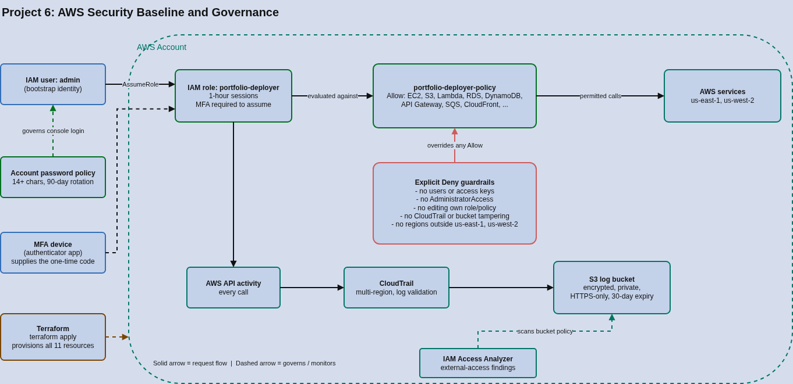

# Project 6: AWS Security Baseline and Governance

## Overview

An audit-then-remediate project: I audited my own AWS account, found five concrete weaknesses, and fixed them with Terraform -- a least-privilege deployer role gated by MFA, an account password policy, a tamper-resistant CloudTrail audit log, and IAM Access Analyzer. Every control was then tested to prove it works, not just assumed.

The whole project runs at **$0**. The paid managed security services (GuardDuty, Security Hub, AWS Config, WAF) were evaluated and deliberately skipped -- see Design Decisions.

## Audit Findings

Starting state of the account, read-only, via the AWS CLI:

| # | Finding | Risk | Fix |
|---|---|---|---|
| 1 | Only IAM user was `admin`, with full `AdministratorAccess` | Any leaked credential = total account compromise | Scoped deployer role with explicit guardrails |
| 2 | No MFA on `admin` | A stolen password or key alone grants full access | Role can only be assumed with MFA |
| 3 | Long-lived access key attached to the admin user | Keys never expire and are easy to leak | Short-lived (1 hour) role sessions for day-to-day work |
| 4 | No CloudTrail trail | No durable record of who did what | Multi-region trail to a locked-down S3 bucket |
| 5 | No account password policy | Weak passwords allowed | 14+ characters, complexity, 90-day rotation, no reuse |

## Architecture



### Access flow

```
Human (IAM user "admin" + MFA code)
        |
        |  sts:AssumeRole  (denied unless aws:MultiFactorAuthPresent = true)
        v
Role "portfolio-deployer"  -- 1-hour temporary credentials
        |
        |  evaluated against portfolio-deployer-policy
        v
 Allow: services the portfolio uses  ->  minus explicit Deny guardrails
        |
        v
 AWS API calls  ----------------------------->  CloudTrail (all regions)
                                                        |
                                                        v
                                        S3 log bucket (encrypted, private, 30-day expiry)

IAM Access Analyzer scans the account for resources shared outside it.
```

### Components

| Component | What It Is | Used Here |
|---|---|---|
| IAM role | An identity with no permanent credentials that trusted principals assume temporarily | `portfolio-deployer`, assumable only by `admin` and only with MFA |
| IAM policy (allow + deny) | JSON rules; an explicit Deny always overrides any Allow | Allow-list of portfolio services plus guardrail Denies |
| MFA | A second factor required alongside the credential | Enforced in the role's trust policy, not just encouraged |
| Account password policy | Account-wide password rules | 14+ chars, complexity, 90-day max age, 5-password history |
| CloudTrail | Records AWS API activity | One multi-region trail with log file validation |
| S3 (log bucket) | Object storage | Private, encrypted, HTTPS-only, bucket policy scoped to this trail, 30-day expiry |
| IAM Access Analyzer | Finds resources shared outside the account | Account-level analyzer for external access |
| Terraform | Infrastructure as code | All 11 resources, reproducible and reviewable |

## Design Decisions

**Why skip GuardDuty, Security Hub, AWS Config and WAF?**
None has a permanent free tier: GuardDuty and Security Hub offer 30-day trials only, Config bills per configuration item recorded, and a WAF web ACL costs roughly $5/month before rules. This portfolio is built to stay at zero spend, so these are documented as a cost decision rather than silently omitted -- the same call as choosing k3s over EKS in Project 5. In a funded environment they would be the next layer.

**Why a role with MFA instead of just trimming the admin user's policy?**
A role issues short-lived credentials that expire on their own, so a leaked session is useful for at most an hour. Requiring MFA in the trust policy means a stolen password or access key is not enough to get in. Separating "the identity" from "the working permissions" also makes the permissions easy to audit in one place.

**Why explicit Denies on top of an allow-list?**
The allow-list uses service wildcards (for example `s3:*`) to stay practical across the portfolio's projects. Explicit Denies are the guardrails that no Allow can override: no creating users or access keys, no attaching `AdministratorAccess`, no editing the deployer role or its own policy (blocks self-escalation), and no stopping or deleting the audit trail or its bucket.

**Why restrict regions?**
Regional API calls outside `us-east-1` and `us-west-2` are denied (global services such as IAM, STS, CloudFront and Route 53 are exempt). A compromised credential can no longer quietly spin up resources in a region nobody is watching. The list is a Terraform variable, so it changes in one line.

**Why S3-managed encryption instead of a KMS key?**
A customer-managed KMS key costs $1/month. SSE-S3 encrypts the logs at rest at no charge. In a regulated environment a customer-managed key would be the better choice, for key-level access control and its own audit trail.

**Why a 30-day log expiry?**
It keeps storage negligible. Production would retain logs far longer to satisfy compliance and investigation needs.

## Verification

Each control was tested against the live account:

| Test | Expected | Result |
|---|---|---|
| Assume role with a valid MFA code | Allowed | Allowed (1-hour session) |
| Assume role with a wrong MFA code | Denied | Denied |
| Assume role with no MFA | Denied | Denied |
| `ec2:RunInstances`, `s3:CreateBucket`, `lambda:CreateFunction` | Allowed | Allowed |
| `iam:CreateUser`, `iam:CreateAccessKey`, `cloudtrail:StopLogging` | Denied | Explicit deny |
| `ec2:RunInstances` in `eu-central-1` (outside approved regions) | Denied | Explicit deny |
| CloudTrail status | Logging, no delivery errors | `IsLogging = True` |

The permission tests used `aws iam simulate-principal-policy`, passing `aws:RequestedRegion` as a context entry because the simulator does not populate it the way a real API call does.

## Cost Analysis

| Resource | Cost |
|---|---|
| IAM roles, policies, password policy | $0 |
| CloudTrail (first management-event trail) | $0 |
| S3 log storage (small volume, 30-day expiry) | Negligible, within free tier |
| IAM Access Analyzer (account-level, external access) | $0 |
| GuardDuty, Security Hub, Config, WAF | Skipped (paid) |
| **Total** | **$0** |

## Known Limitations

- **Inline policy escalation:** the guardrail blocks attaching `AdministratorAccess` and `IAMFullAccess` as managed policies, but the role may still write inline role policies. The production fix is a permissions boundary on every role the deployer creates; I did not apply one here because it would require changing every role in Projects 1-5.
- **Original admin user still exists:** its access key remains active as the bootstrap identity. The next hardening step is to move the CLI to an assume-role profile and deactivate that key.
- **Local Terraform state:** state is stored locally, not in a remote backend with locking.

## Deployment

### Prerequisites

- AWS CLI configured with an administrator identity, and an MFA device assigned to that IAM user
- Terraform 1.5 or newer

### Deploy

```
cd terraform
terraform init
terraform plan
terraform apply
```

### Verify

```
aws cloudtrail get-trail-status --name portfolio-trail --query '[IsLogging,LatestDeliveryError]' --output text

aws sts assume-role --role-arn arn:aws:iam::<ACCOUNT_ID>:role/portfolio-deployer \
  --role-session-name deploy --serial-number <MFA_DEVICE_ARN> --token-code <CODE> \
  --query 'Credentials.Expiration' --output text

aws iam simulate-principal-policy --policy-source-arn arn:aws:iam::<ACCOUNT_ID>:role/portfolio-deployer \
  --action-names iam:CreateUser ec2:RunInstances \
  --context-entries ContextKeyName=aws:RequestedRegion,ContextKeyValues=us-east-1,ContextKeyType=string \
  --query 'EvaluationResults[].[EvalActionName,EvalDecision]' --output table
```

### Tear down

```
terraform destroy
```

Run this as the administrator identity, not the deployer role -- the role is explicitly denied from modifying its own policy and the audit bucket. Destroying the stack also removes the trail, so only do it once the demo is finished.

## What I Learned

- Auditing before building mattered: five specific, evidence-backed findings turned a vague "improve security" goal into a checklist where each fix traces back to a real gap.
- An explicit Deny beats any Allow, so wildcard allow-lists stay manageable as long as the guardrails (no user or key management, no self-editing, no tampering with the audit trail) are written as Denies.
- Negated condition operators such as `StringNotEquals` evaluate to true when the key is missing. The region guardrail therefore denied everything in the policy simulator until I supplied `aws:RequestedRegion` as context -- real API calls always include it, but the simulator does not.
- Testing the negative cases (no MFA, wrong MFA code, out-of-region, forbidden actions) is what separates a policy that looks right from one that is right. A wrong MFA code in testing actually confirmed enforcement was live.
- Cost is a legitimate architecture input: documenting why GuardDuty, Security Hub, Config and WAF were skipped is stronger than leaving them out unexplained.
- A permissions boundary, not just a deny list, is the proper answer to IAM privilege escalation -- worth knowing even though this account's scope did not justify retrofitting it.
