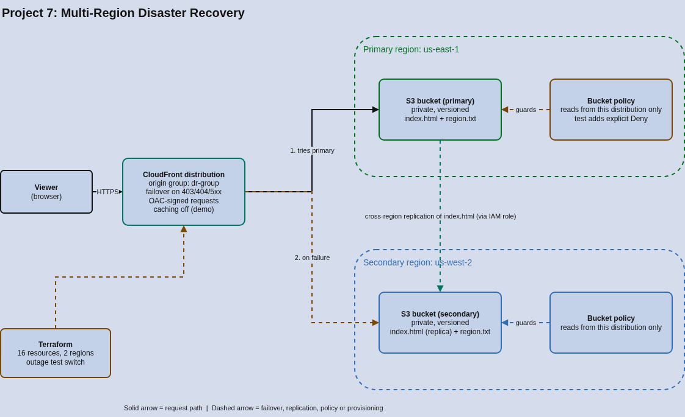

# Project 7: Multi-Region Disaster Recovery (S3 Replication + CloudFront Failover)

## Overview

A static site that survives the loss of its primary AWS region. Content is replicated from S3 in us-east-1 to S3 in us-west-2, and a CloudFront origin group automatically serves from the secondary region when the primary origin fails. I then triggered a simulated primary outage, watched traffic fail over to us-west-2, restored the primary, and measured what the failover cost.

The whole project runs at effectively **$0**. The paid DR building blocks (Route 53 failover routing, cross-region databases) were evaluated and deliberately skipped -- see Design Decisions.

## Architecture



### Request and replication flow

```
Viewer
  |
  v
CloudFront distribution  (origin group "dr-group", failover on 403/404/500/502/503/504)
  |
  +--> primary origin:   S3 bucket, us-east-1   (always tried first)
  |         |
  |         |  cross-region replication (index.html, versioned, IAM replication role)
  |         v
  +--> secondary origin: S3 bucket, us-west-2   (used only when the primary fails)
```

### Components

| Component | What It Is | Used Here |
|---|---|---|
| S3 bucket (primary) | Object storage in one region | Holds the site in us-east-1; private, versioned |
| S3 bucket (secondary) | Object storage in a second region | Receives replicated content in us-west-2; private, versioned |
| S3 cross-region replication | Asynchronous copy of new objects to a bucket in another region | Replicates `index.html` from primary to secondary using a dedicated IAM role |
| CloudFront | CDN in front of the origins | Single public URL for both regions |
| CloudFront origin group | Two origins with automatic failover rules | Tries the primary; retries the same request on the secondary on 403/404/5xx |
| Origin access control (OAC) | Lets CloudFront read private S3 buckets with signed requests | Buckets stay private; only this distribution can read them |
| Bucket policies | Resource-based access rules | Allow reads from this distribution only; also carry the outage-simulation switch |
| Terraform | Infrastructure as code | All 16 resources across two regions, using a provider alias for the secondary |

## Design Decisions

**Why CloudFront origin failover instead of Route 53 failover routing?**
Route 53 failover needs a hosted zone ($0.50/month), health checks ($0.50/month each) and a registered domain -- none of it free. CloudFront origin groups give automatic failover with no extra service, and they fail over per request, so there is no DNS TTL to wait out.

**Why replicate static content instead of a database?**
The stateful tiers are where DR gets expensive: cross-region RDS replicas, Aurora Global Database and DynamoDB global tables are paid or cannot be confirmed free. Static content shows the same pattern -- replicate, detect failure, fail over, fail back -- at no cost. The limitation is real and listed below.

**Why is `region.txt` not replicated?**
To make failover visible. `index.html` replicates, but each bucket keeps its own `region.txt` ("PRIMARY us-east-1" / "SECONDARY us-west-2"). The replication rule filters by key prefix, so only the page replicates, and the marker file shows which region answered any request.

**Why is caching disabled on the distribution?**
So every request reaches an origin and failover shows up immediately. In production you would cache; cached objects would then keep being served from the edge, and failover would only apply on cache misses.

**Why simulate the outage with a bucket policy?**
A real regional outage cannot be triggered on demand. A `simulate_primary_outage` Terraform variable adds an explicit Deny for CloudFront on the primary bucket, so CloudFront receives a 403 from the primary origin -- one of its configured failover signals. It is reversible, defined in code, and touches one resource. It is not a perfect stand-in for a real outage (see Known Limitations).

**Why private buckets with OAC?**
Neither bucket is public. Both policies allow reads only from this specific distribution, so the CDN is the only way in.

## Results

Failover test, run from a client in Saudi Arabia against the CloudFront URL (5 requests per state, single run):

| State | Marker returned | HTTP status | Response time |
|---|---|---|---|
| Healthy | PRIMARY us-east-1 | 200 | about 0.57-0.59 s (first request 0.90 s) |
| Primary failing | SECONDARY us-west-2 | 200 | about 1.03-1.05 s (first request 1.18 s) |
| Primary restored | PRIMARY us-east-1 | 200 | back to about 0.57 s |

- **Failover time:** the first request after the outage began was already answered from us-west-2. Failover happens per request, with no detection delay in this simulation.
- **Failover cost:** roughly 0.45-0.5 s extra per request -- the failed attempt at the primary plus the longer trip to us-west-2. The test cannot separate the two.
- **Site page during the outage:** the full `index.html` loaded from the secondary.
- **Replication lag (data-loss window):** a test object appeared in us-west-2 after 26 seconds (one measurement). Standard S3 replication has no time guarantee; Replication Time Control, which does, is a paid feature and was skipped.
- **Failback:** removing the Deny returned traffic to the primary immediately.

## Cost Analysis

| Resource | Cost |
|---|---|
| S3 storage, two regions (a few KB, versioned) | Negligible |
| S3 replication requests and inter-region transfer (KB scale) | Fractions of a cent |
| CloudFront (a handful of test requests) | Within the monthly free allowance |
| IAM role and policies | $0 |
| Route 53 hosted zone, health checks, domain | Skipped (paid) |
| RDS cross-region replica, Aurora Global, DynamoDB global tables | Skipped (paid / unverifiable) |
| S3 Replication Time Control | Skipped (paid) |
| **Total** | **Effectively $0** |

## Known Limitations

- **Static content only:** there is no database or stateful tier, so this does not demonstrate data-layer DR, which is the hard and expensive part.
- **One-way replication:** changes made in the secondary during a failover are not copied back to the primary.
- **Simulated outage:** the test produces an instant 403. Real regional failures often show up as timeouts or 5xx errors, and CloudFront's origin timeout and retry settings would add delay before failover. That path was not tested.
- **Only GET and HEAD fail over:** CloudFront origin groups do not fail over other request methods; fine for a static site, not for an application.
- **Single measurement:** the timing and replication numbers come from one run and are indicative, not statistical.
- **Local Terraform state:** no remote backend or locking.

## Deployment

### Prerequisites

- AWS CLI configured with permissions for S3, CloudFront and IAM
- Terraform 1.5 or newer

### Deploy

```
cd terraform
terraform init
terraform apply
```

### Test failover

```
# Healthy: should report PRIMARY us-east-1
curl -s <site_url>/region.txt

# Simulate a primary outage: should now report SECONDARY us-west-2
terraform apply -var simulate_primary_outage=true
curl -s <site_url>/region.txt

# Fail back: should report PRIMARY again
terraform apply
curl -s <site_url>/region.txt
```

### Tear down

```
terraform destroy
```

The buckets use `force_destroy`, so versioned objects are removed with them. Deleting the CloudFront distribution takes a few minutes.

## What I Learned

- A CloudFront origin group fails over per request, so recovery has no DNS TTL to wait out -- a real advantage over DNS-based failover, but it only covers GET and HEAD and only the status codes you list.
- S3 replication copies only objects created after the rule exists, so the page upload has to be ordered after the replication configuration in Terraform.
- Failover is not free in latency: about half a second more per request here, because the failed primary attempt and the more distant secondary both add time.
- A simulated outage proves the failover mechanism, not every real failure mode. Writing down what the simulation does not cover is part of the result.
- The expensive part of DR is the stateful tier and the DNS layer, not the stateless content, which is why a zero-cost build can still demonstrate the pattern but not the whole problem.
- Measuring recovery behavior, even from a single run, turns "it should fail over" into numbers a reviewer can check.
