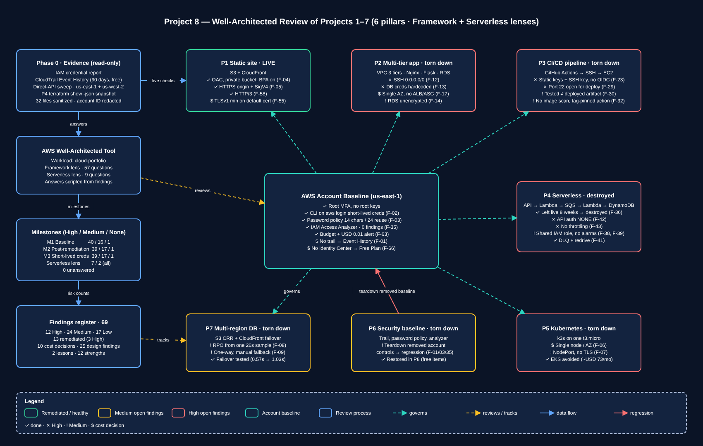

# Project 8: Well-Architected Review of Projects 1–7

An evidence-based AWS Well-Architected review of the whole portfolio — Projects 1–7 plus the AWS account they run in —
across all six pillars, recorded in the AWS Well-Architected Tool with three milestones, followed by free remediations
that were each verified independently.

## Overview

The review had two kinds of evidence:

| Evidence | Applies to | Source |
|---|---|---|
| **Live** (verified with the AWS CLI on 2026-10-26/27) | AWS account, Project 1 (the only project kept running), leftover sweep | Read-only CLI checks, saved in [`evidence/`](evidence/) |
| **As-built** (design review) | Projects 2–7 (torn down) | READMEs, Terraform, workflow files, recorded test results, a `terraform show -json` snapshot for P4 |

**Headline results**

- **69 findings** in one register ([`findings/findings-register.md`](findings/findings-register.md)): 12 High, 24 Medium, 17 Low, 16 strengths or closed items.
- **13 remediated and verified**, including 3 of the 12 Highs. Every fix was free.
- **The live review found a forgotten workload.** Project 4 had never been destroyed and ran for about 8 weeks, with an unauthenticated, unthrottled public API (F-36, F-42, F-43). It was found through an IAM role's "last used" timestamp, captured as evidence, destroyed and verified.
- **Tearing down Project 6 brought back the security gaps it had fixed.** The account-level controls (trail, password policy, Access Analyzer) were in the project stack, so tearing it down deleted them. That's the central lesson: **account baseline controls need a lifecycle separate from projects.**
- The October bill was **USD 0.00**. Every paid alternative is recorded as an explicit cost decision.

## Architecture



Editable source: [`diagrams/portfolio-wa-map.drawio`](diagrams/portfolio-wa-map.drawio).

```
                Phase 0: Evidence (read-only, free)
  credential report · password policy · trails · analyzers · IAM roles
  Lambda/ESM inventory · Terraform state ownership · direct-API sweep
                               |
          +--------------------+--------------------+
          |                                         |
  Unplanned cleanup                       Phase 1: Design review
  P4 (21 resources) + log groups          P2, P3 (README, architecture.md,
  SAM bootstrap stack + versioned bucket  ci-cd.yml), P4 state snapshot,
  -> each verified gone                   P5-P7 READMEs
          |                                         |
          +--------------------+--------------------+
                               v
              Phase 2: AWS Well-Architected Tool
     workload "cloud-portfolio" · Framework lens (57 Q) + Serverless lens (9 Q)
     answers scripted from findings -> M1 Baseline
                               |
                               v
              Phase 3: Free remediations, then re-measure
     P1 OAC + private bucket + HTTP/3 · password policy · Access Analyzer
     $0.01 budget alert · aws login short-lived CLI credentials
     -> M2 Post-remediation -> M3 Short-lived credentials
                               |
                               v
              Phase 4: Findings register · pillar pages · this README
```

## Components

| Component | What It Is | Used Here |
|---|---|---|
| AWS Well-Architected Tool | Free AWS service for recording workload reviews against lenses, with milestones and reports | Workload `cloud-portfolio`; 66 answers scripted from the findings register; milestones M1–M3 |
| Well-Architected Framework lens | The six-pillar question set (57 questions) | Main review |
| Serverless Lens | Extra lens for Lambda/API Gateway/SQS designs (9 questions) | Project 4 |
| IAM credential report | CSV of every principal's password, MFA and access-key usage | Found the long-lived admin key and the root sign-in |
| CloudTrail Event History | Free 90-day record of management events, with no trail needed | Compensating control for the missing trail; explained the root session; recorded every remediation |
| IAM Access Analyzer | Free external-access analysis of resource policies | Recreated; independently confirmed the P1 bucket is no longer public |
| AWS Budgets | Cost thresholds with email alerts | Existing USD 5 budget plus a new USD 0.01 alert |
| Resource Explorer | Cross-service resource inventory | Tried for the leftover sweep; index was stale and partial (F-53) |
| `scripts/sweep.sh` | Read-only direct-API leftover sweep across us-east-1 and us-west-2 | Teardown verifier with per-call timeouts |
| CloudFront Origin Access Control | SigV4-signed origin requests to a private S3 bucket | P1 remediation (F-04, F-05) |
| `aws login` + `credential_process` | AWS CLI browser sign-in with MFA issuing temporary credentials; `credential_process` passes them to Terraform | Replaced the long-lived admin access key (F-02) |
| `wa-tool/scripts/wa_apply.py` | Script that applies `answers.json` and creates milestones and reports | Reproducible WA Tool record |

## Design Decisions

**Why review the account as well as the projects?**
The worst gaps were in the account, not in any one project. Deleting the P6 stack also deleted the trail, password
policy and analyzer, and a P4 deployment had been forgotten. A project-by-project review would have missed both.

**Why is the review based on evidence, not memory?**
Every live claim has a saved CLI output. That's what caught the surprises: the P4 leftover (role last-used timestamp),
a stale inventory index (F-53), and the reason for a root sign-in (Event History showed MFA setup, not misuse).

**Why capture P4's configuration before destroying it?**
`terraform destroy` empties the state. Exporting `terraform show -json` first kept every attribute needed for the
design review: auth, throttling, timeouts, IAM, encryption, tracing.

**Why script the WA Tool answers?**
66 questions by hand is slow and hard to repeat. `answers.json` stores the selected choices for each milestone, with
notes citing finding IDs, so the WA Tool record links back to the register. Every choice ID was validated against the
lens export before applying.

**Why does the High risk count barely move (40 → 39)?**
The WA Tool rates a question High if *any* of its high-risk best practices is missing. A single-account, zero-spend
learning setup with no paid monitoring, incident process or multi-account structure trips most questions. The
milestones are honest. The remediated findings are the real measure of progress.

**Why not IAM Identity Center?**
Identity Center itself is free, but enabling it creates an AWS Organization, which moves the account from the Free Plan
to pay-as-you-go and expires the remaining credits (the console warns about this before enabling). `aws login` gives the same
property that mattered, short-lived CLI credentials behind MFA, with no account change (F-66).

**Why keep the WA Tool PDF reports out of Git?**
They contain the account ID and workload ARN. The account ID has never been committed (F-64), so the PDFs are
git-ignored and the risk counts are summarised below instead. Published evidence is sanitized by `scripts/sanitize-evidence.sh`.

## Results / Verification

### Well-Architected Tool milestones

| Milestone | Framework lens (High / Medium / None) | Serverless lens (High / Medium) |
|---|---|---|
| M1 Baseline (pre-remediation) | 40 / 16 / 1 | 7 / 2 |
| M2 Post-remediation (P1 OAC, password policy, Access Analyzer, cleanup) | 39 / 17 / 1 | 7 / 2 |
| M3 Short-lived CLI credentials, admin key deactivated | 39 / 17 / 1 | 7 / 2 |

All 66 questions answered in every milestone (0 unanswered). The Serverless lens doesn't change because P4 was
reviewed as built and then destroyed rather than redesigned.

### Remediations (all verified)

| Finding | Before | After | Evidence |
|---|---|---|---|
| F-04 / F-05 / F-54 P1 bucket | Direct S3 `200`; Block Public Access all off; origin `http-only` | Website endpoint `404`, direct object `403`, CloudFront `200`; BPA all on; `IsPublic=False`; HTTPS + SigV4 via OAC | 18, 19 |
| F-58 P1 protocol | `http2` | `http2and3`, `alt-svc: h3` | 19 |
| F-36 P4 leftover | 3 Lambdas, SQS mapping polling 24/7, API, queues, table, role | `terraform destroy` (21), each service checked empty, role `NoSuchEntity` | 05, 09 |
| F-40 P4 log groups | 3 never-expire log groups orphaned by destroy | Deleted, none remaining | 09, 10 |
| F-37 / F-52 SAM leftovers | Bootstrap stack + bucket with 8 versions and 8 delete markers | Emptied, stack deleted, stack "does not exist", bucket `404` | 11–13 |
| F-03 Password policy | `NoSuchEntity` | 14 chars, 4 classes, 24 reuse, no forced expiry | 02, 20 |
| F-35 Access Analyzer | None | `ACTIVE`, 0 findings | 21 |
| F-63 Budget | First alert at USD 4 | Added ACTUAL > USD 0.01 alert | 22, 28 |
| F-02 Admin access key | `AKIA` key, 68 days old, used for all CLI work | CLI and Terraform on `ASIA` temporary credentials via `aws login`; key `Inactive`; old profile `InvalidClientTokenId` | 30–32 |
| F-60 Repo hygiene | `*tfplan*` not ignored; stray empty root state file | Ignored; removed | 17, 34 |

### Leftover sweep (after cleanup)

Direct APIs across us-east-1 and us-west-2 checked EC2 instances, EBS volumes and snapshots, Elastic IPs, VPCs, key
pairs, RDS instances, snapshots, parameter and subnet groups, REST and HTTP APIs, Lambda, CloudFormation and log groups.
**All empty.** The only resources left are P1's bucket and distribution (evidence 14).

## Cost Analysis

| Item | Cost |
|---|---|
| Well-Architected Tool, IAM Access Analyzer (external access), CloudTrail Event History, IAM password policy, Budgets alerts, CloudFront OAC, HTTP/3, `aws login` | USD 0 |
| October 2026 invoice | **USD 0.00** (raw usage USD 0.017, covered by Free Plan credits) |

**Cost decisions**: known gaps accepted under the zero-spend rule

| Skipped | Why it matters | Compensating control / note |
|---|---|---|
| CloudTrail trail to S3 (F-01) | Long-term, tamper-evident audit log | 90-day Event History, verified |
| GuardDuty, Security Hub, AWS Config, Inspector, Macie | Threat detection, posture and compliance | Access Analyzer, credential report, this review |
| IAM Identity Center (F-66) | Central identity provider | Free itself, but the Organization would end the Free Plan; `aws login` used instead |
| Custom domain + ACM (F-55) | TLSv1.2+ minimum on CloudFront | Default certificate; viewer HTTPS enforced |
| CloudFront and VPC Flow Logs storage (F-56, F-19) | Request and network forensics | — |
| Multi-AZ, ALB, NAT Gateway, EKS (F-17, F-18, F-06) | High availability | Documented production alternatives per project |
| DynamoDB PITR, S3 RTC (F-49, F-08) | Point-in-time recovery, replication SLA | Data reproducible from Git/IaC |
| WAF, Business Support (full Trusted Advisor) | Edge protection, extra checks | — |

## Known Limitations

- **P2–P7 are reviewed from documents, not live resources.** Their findings are *Design findings*, each with the free fix written down but not rebuilt.
- **One reviewer.** The same person built and reviewed the workloads, without an independent second review.
- The WA Tool risk counts reflect a learning account measured against production practice; they aren't a maturity score.
- The deactivated admin access key still exists until it's deleted after a soak period.
- `aws login` sessions expire, so the CLI needs a browser sign-in about once a day. Terraform can't read these sessions natively and goes through a `credential_process` profile.
- No recurring review cadence yet. The milestones are one-off.

## Deployment

How to reproduce the review in another account. All steps are read-only except the remediations.

```bash
cd project-8-well-architected

# 1. Evidence and leftover sweep (read-only)
aws iam generate-credential-report && aws iam get-credential-report --query Content --output text | base64 -d
bash scripts/sweep.sh

# 2. Well-Architected Tool
aws wellarchitected create-workload --workload-name cloud-portfolio --environment PREPRODUCTION \
  --review-owner "<name>" --aws-regions us-east-1 us-west-2 --lenses wellarchitected serverless \
  --description "<text>" --query WorkloadId --output text > evidence/raw/23-wa-workload-id.txt
python3 wa-tool/scripts/wa_apply.py baseline   # all answers + Milestone 1
python3 wa-tool/scripts/wa_apply.py post       # post-remediation answers + Milestone 2 + PDF reports

# 3. Publish evidence without account identifiers
bash scripts/sanitize-evidence.sh
```

Remediation code lives with the project it changes, e.g. P1's OAC change in `project-1-static-site/terraform/`.

## What I Learned

- **Account baseline ≠ project resources.** Putting account-wide controls (trail, password policy, analyzer) in a project stack means tearing the project down removes them.
- **"Torn down" needs proof, not memory.** A whole serverless stack survived for 8 weeks. An IAM role's *last used* timestamp gave it away.
- **Inventory services lag behind reality.** Resource Explorer still listed deleted APIs and missed a region. Teardown checks need direct service APIs.
- **Capture before you destroy.** `terraform show -json` kept the P4 design reviewable after the resources were gone.
- **Read console warnings, not just price lists.** Identity Center is free, but enabling it would have ended the Free Plan.
- **Short-lived credentials have tooling gaps.** `aws login` works for the CLI, but Terraform needed a `credential_process` bridge, and expired sessions also need a saved region.
- **Audit logs answer questions memory can't.** Event History explained the root sign-in and the "missing" plan file (it had already been applied).
- **Pipes hide failures.** `cmd | tee` returned success after Terraform failed. `set -o pipefail` and exact-match guards now protect applies.
- **Versioning without lifecycle rules keeps "deleted" data forever.**
- **Free controls missed are the cheapest findings to fix:** RDS encryption at rest, stage throttling, per-function IAM roles, Session Manager instead of SSH.
